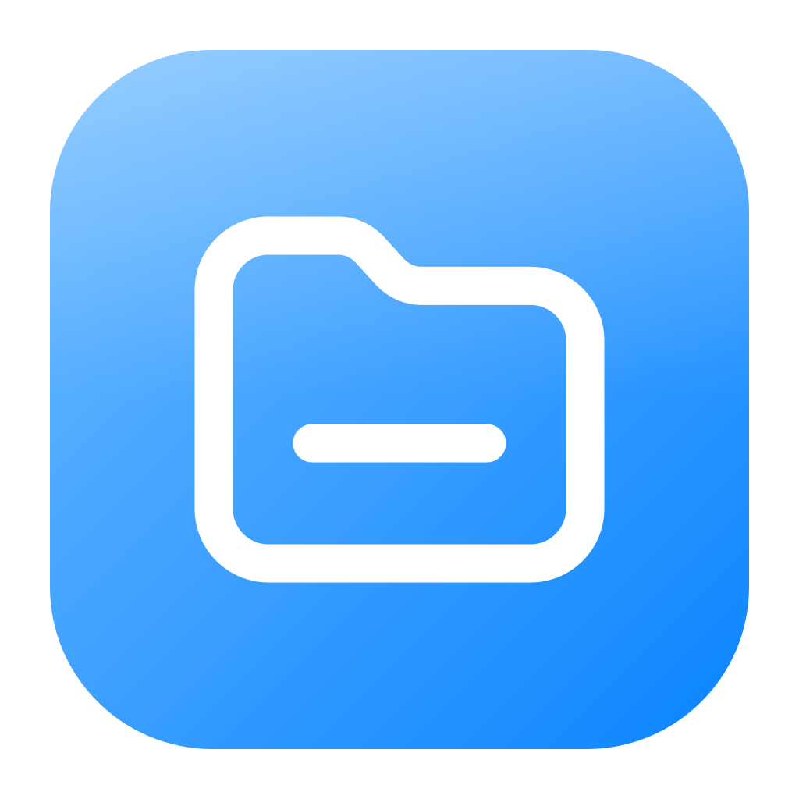
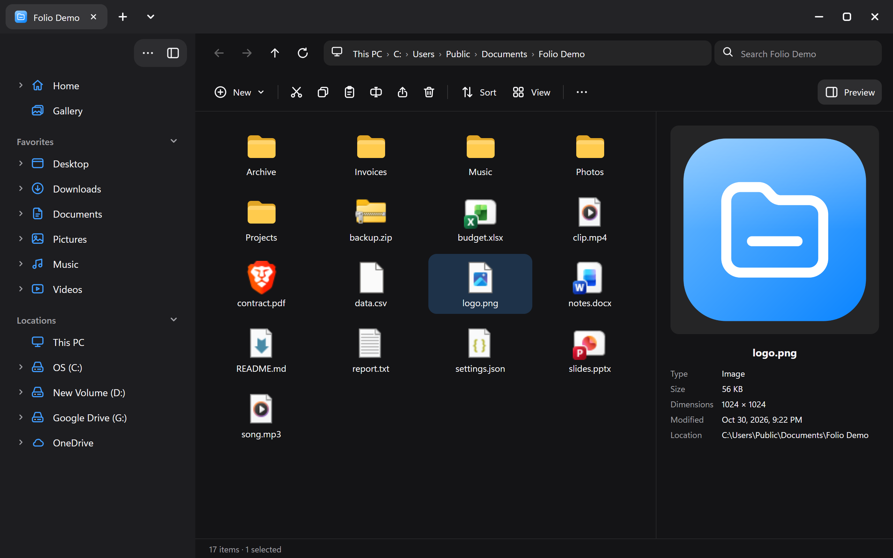

<p align="center">
  
</p>

<h1 align="center">Folio</h1>

<p align="center">
  A fast, good-looking file manager for Windows.<br>
  Dark-first design, a folder-tree sidebar, live previews, drag and drop, and undo.
</p>

<p align="center">
  
</p>

## Download

Get the latest version from the **[Releases page](../../releases/latest)**:

| File | What it is |
|---|---|
| `Folio-Setup-<version>.exe` | Installer. Adds Start menu and desktop shortcuts, and uninstalls from Windows Settings. |
| `Folio-<version>-portable.exe` | No installation: download and run. |
| `TitleBarStyler.exe` | Optional extra that gives *every* window the Folio title bar (see [below](#titlebarstyler-optional)). |

Requires Windows 10 or 11 (64-bit).

> **"Windows protected your PC"?** The app is not code-signed yet, so SmartScreen warns the first time.
> Click **More info → Run anyway**.

## Features

- **Folder tree sidebar** with Favorites and Locations. Click the arrow next to any folder to expand it. Pin your own folders to Favorites.
- **Live preview** (press `Space`): images with dimensions, text and code, video, audio, PDF, folder contents.
- **Drag and drop** between folders, the sidebar and the address bar. Hold `Ctrl` to copy. Drop files in from other apps.
- **Undo** (`Ctrl+Z`) for move, copy, rename and new items.
- **Conflict prompts**: Replace, Keep both or Skip, and replaced files go to the Recycle Bin, not into the void.
- **Works with the Windows clipboard**: copy in Folio, paste in Explorer, and the other way round.
- **Editable address bar** with folder suggestions (`Ctrl+L`).
- **Keyboard first**: arrow keys, `Home`/`End`, type-to-select, `Shift` to extend a selection.
- Grid and list views, sorting, search, real Windows file icons, custom title bar, remembers its window size.
- Open a folder straight from the command line: `Folio.exe "D:\Projects"`.

### Shortcuts

| Key | Action |
|---|---|
| `Space` | Show or hide the preview |
| `Ctrl+L` / `Alt+D` / `F4` | Edit the address bar |
| `Ctrl+F` | Search this folder |
| `Ctrl+C` / `Ctrl+X` / `Ctrl+V` | Copy, cut, paste |
| `Ctrl+Z` | Undo |
| `Ctrl+A` | Select all |
| `Ctrl+Shift+N` | New folder |
| `F2` | Rename |
| `Delete` | Move to the Recycle Bin |
| `Enter` | Open |
| `Backspace` / `Alt+↑` | Up one folder |
| `Alt+←` / `Alt+→` | Back / forward |
| `F5` | Refresh |

## TitleBarStyler (optional)

A small tray app (in [`tools/TitleBarStyler`](tools/TitleBarStyler)) that gives the title bar of **every normal window** the same look: dark bar and rounded minimize/maximize/close buttons with a red close hover. It follows your light/dark setting and puts everything back when you choose **Exit** from its tray icon.

- Apps that draw their own title bar (Chrome, Edge, VS Code, Discord, Spotify and similar) are left alone. Use **Edit excluded apps…** in the tray menu to add more.
- Windows that are bitmap-scaled (old DPI-unaware apps on a scaled monitor) keep their native buttons.
- The Windows 11 snap-layout flyout on the maximize button is not shown for restyled windows.

## Build from source

```
git clone https://github.com/OWNER/folio.git
cd folio
npm install
npm start          # run in development
npm run dist       # build the installer and portable exe into dist/
```

Build TitleBarStyler (no SDK needed, it uses the compiler that ships with Windows):

```
powershell -ExecutionPolicy Bypass -File tools\TitleBarStyler\build.ps1
```

To regenerate the icons after editing `build/icon.svg`, run `npm run icons`.

### Releasing

Push a version tag and GitHub Actions builds everything and attaches it to a release:

```
git tag v1.0.0
git push origin v1.0.0
```

## Design

The visual design (colors, sizes, the 29 icons, the sidebar structure) is documented in [`docs/design-spec.md`](docs/design-spec.md).

## License

[MIT](LICENSE)
